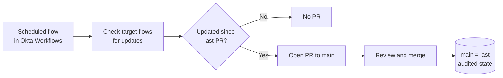

# oktawf-automated-uar-change-log
Okta WF Autmated UAR Change Log

An audit trail of changes to Okta Workflows.

A scheduled Okta Workflow checks a set of target flows. Whenever one of
them has been updated, it submits the update as a pull request against
`main`. The PR history lets audit see exactly what has changed since the
last PR.

> **This repo is for audit, not for restoring flows.**
> Restore flows with **Okta Workflows Version Control**.
> GitHub keeps the record of every change.

---

## How it works

1. **Trigger:** a scheduled flow in Okta Workflows runs on a set cadence.
2. **Detect:** it checks each target flow for updates.
3. **Submit:** each update becomes a pull request against `main`.
4. **Audit:** a reviewer looks at the PR and merges it. `main` then
   holds the last audited state, and the next PR shows only what changed
   after that.

| Detail | Value |
|---|---|
| Schedule | _TBD_ |
| Scheduled flow name | _TBD_ |
| PR granularity (one per flow / one per run) | _TBD_ |

---

## Target flows

These are the Okta Workflows the scheduled flow monitors.

| Flow | Folder |
|---|---|
| _TBD_ | _TBD_ |

Change this list in the scheduled flow itself. Update this table in the
same PR so the README stays accurate.

---

## Reviewing a PR

Each PR shows what changed in a target flow since the last merged PR.
When you review one:

- Confirm the change was authorized, for example by linking it to its
  change ticket or approval.
- Check for unexpected or unexplained edits.
- **Merge rather than close.** Closing a PR leaves `main` out of date,
  so the next PR will include those changes again.

---

## Restoring a flow

Restores are done **only** through **Okta Workflows Version Control**:

1. In Okta Workflows, open the flow's version history.
2. Choose the version you need and restore it.
3. The restore is itself a change, so the next scheduled run records it
   as a new PR. The audit trail stays complete.

Do not import files from this repo into Okta Workflows to restore a
flow. They are an audit record, not a restore source.

---

## Repository rules

- All changes reach `main` through pull requests opened by the
  automation. Do not push directly to `main`.
- Do not hand-edit recorded flow files. Once edited, a file no longer
  reflects what was in Okta Workflows.

---

## Contacts

| Role | Contact |
|---|---|
| Owner | _TBD_ |
| Audit contact | _TBD_ |
